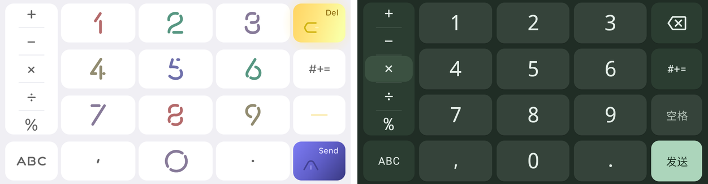

<div align="center">


# SeepType

**用中文打字，顺便记一个英文词。**

离线拼音输入法，英文释义就写在中文候选的上方。<br>
An offline pinyin keyboard that shows English glosses above the Chinese candidates.

[下载 Android 预览版 0.1.0-preview.6](https://github.com/margerit0/SeepType/releases/tag/android-v0.1.0-preview.6) · [**Releases**](https://github.com/margerit0/SeepType/releases) · [安装与启用](#安装) · [从源码构建](#从源码构建)

</div>

https://github.com/user-attachments/assets/2132cab7-4133-41a2-a231-51dcab796751

<sub>合成演示，约 40 秒，有配乐（GitHub 的播放器默认静音）。键盘和详情卡是 0.1.0-preview.4 在 Android 模拟器上的截图，轻彩皮肤；触控圆点、候选描边和镜头推拉是后期加的，开头和结尾是手绘动画，操作过程有压缩。</sub>

## 打字时是什么样

单词书翻开，又是 abandon。可字，你每天都在打。拾词让英文长在你打的字上：拼音照打，有释义的候选上方多一行英文；点候选，上屏的还是中文。不用另找时间，打字就好。

用全拼打一句「这个问题我们一起解决」，一个词一个词打下来，会看到：

| 输入 | 候选 | 候选上方的英文 |
| --- | --- | --- |
| `zhege` | 这个 | this |
| `wenti` | 问题 | issue |
| `women` | 我们 | us |
| `yiqi` | 一起 | together |
| `jiejue` | 解决 | solve |

想多看一眼，就长按候选：


- **点候选**：输入中文，和平常打字一样。
- **长按候选**，或点键盘左下角的详情键：打开单词详情。默认译法排在最前，同一读音的其他义项连同词性、中文用法列在后面，有的还带搭配和中英例句。「解决」就能对照 `solve a problem`（解决问题）和 `settle a dispute`（解决争端）。
- **点「输入 solve」**：只有这一下会把英文送进输入框。直接关掉卡片，输入不受影响。
- **空格和回车**：拼音还没选词时，按下去是把字母原样上屏，不会替你选第一个候选。要中文，点候选就好。

释义跟着读音走：打 `hai` 出来的「还」标 even，打 `huan` 出来的「还」标 return。

## 功能

- **三种拼音方案**：全拼、自然码双拼、小鹤双拼，共用同一份词库和本机选词记录。
- **两个互不影响的开关**：「显示英文释义」和「记住中文选词习惯」。工具栏上的英译图标可以随时收起英文；哪个词不想被记住，在它的详情卡里点「忘记这个词的选词习惯」。
- **两套皮肤**：默认和轻彩，各有浅色、深色，也能跟随系统；键盘高度和字号可调。见[皮肤说明](docs/android-skins.md)。
- **数字与符号**：九宫格数字页，左侧运算符栏可以按住滑选 `+ − × ÷ %`；轻彩皮肤的字母键长按输入左下角的数字或符号。
- **表情和剪贴板**：表情面板不联网、不下载表情包；[剪贴板历史](docs/android-clipboard.md)默认关闭，开启后最多保留 50 条，只存在本机。
- **离线词库**：约 12.4 万行中文词典，其中 10,718 个「词 + 读音」带默认英文释义；另附 420 条影视、游戏专名和 [1,000 条日常、网络及游戏词组](android/rime/study_phrases.dict.yaml)。新增词组提供中文候选。见[词库快照](data/lexicon-expansion/android-runtime/README.md)和[专名来源](data/lexicon-expansion/android-names/README.md)。
- **离线英文补全**：在普通文本框中可以直接选中 `home` 等原文候选。切到「英」后，输入 `hom` 可点选 `home`，最多显示三条补全。
- **词频备份**：在键盘设置中导出或导入 TSV。导入时合并本机记录，相同词条和拼音保留较高的选词次数。




<sub>上：轻彩皮肤的字母页。下：九宫格数字页，左为轻彩浅色，右为默认深色。</sub>

## 安装

**preview.6 更新。** 从系统选择框切换键盘后，安装引导会立即更新。开启英文释义时，候选栏里的英文原文和中文候选底对齐。自然码和小鹤双拼输入三个字母时优先匹配前两个字母组成的完整音节，例如 `rhn` 可找到「让你」。

目前可以安装的是 Android 公开预览版，要求 Android 10（API 29）及以上，APK 同时包含 `arm64-v8a` 和 `x86_64`。

1. 打开 [0.1.0-preview.6 发布页](https://github.com/margerit0/SeepType/releases/tag/android-v0.1.0-preview.6)，下载 `StudyIME-0.1.0-preview.6-arm64-x86_64.apk`。发布页附有 `SHA256SUMS.txt`，可以核对文件。
2. 安装后打开「SeepType」，依次点「启用拾词」和「切换键盘」，在系统的选择框里选 SeepType。
3. 回到拾词点「试打几句」。用全拼打 `jiejue`：点「解决」输入中文；长按它打开英文详情，不会直接提交英文。

升级之前：

- 装过 GitHub 发布的 `preview.5`，可以直接覆盖升级。
- 装过自己构建的开发签名版本，签名不同，无法互相覆盖。卸载会删除本机的选词记录，不要为了试用卸掉正在用的版本。

文件名里的 StudyIME 是拾词的工程名，包名（`org.studyime.android`）和源码里也沿用它。

## 隐私与数据

启用任何第三方输入法时，Android 都会提示它可能读到你输入的全部内容。拾词把事情都留在设备上：

- 拼音转换、选词学习和查释义全部离线完成，应用不申请网络权限。
- 选词记录由三种方案共用，不参与系统云备份。卸载应用会删除本机记录。可以手动导出 TSV 迁移，文件中可能含有你选过的词组。
- 在密码输入框里，释义和选词学习自动关闭；应用要求停用个性化时，拾词暂停记录。
- 剪贴板历史默认关闭。开启后也只存本机；密码框、标记为敏感的内容、图片和过长的文本不记录。

## 预览版的边界

这是公开预览，不是正式版：

- **词义可能有误。** 13,429 条英文义项经过 AI 语义审校和自动引擎回归，没有逐条人工复审。
- **还没有系统的真机验证。** 真机和 16 KiB 页面设备上的运行仍待验证。最低系统版本和打包架构，不等于所有设备都已实测。

本版验证范围见 [preview.6 发布说明](https://github.com/margerit0/SeepType/releases/tag/android-v0.1.0-preview.6)，历次验证见[验证记录](docs/android-validation.md)。释义不对、装不上或打不了字，欢迎[提 Issue](https://github.com/margerit0/SeepType/issues)，带上机型和 Android 版本会很有帮助。

## Windows 版

Windows 11 x64 版仍在实验阶段，暂不提供面向普通用户的安装包；之后会独立发布，不影响 Android 的版本节奏。想研究可以从这里开始：[Windows 打包](docs/packaging.md) · [已安装环境的验收记录](docs/installed-desktop-acceptance.md) · [扩展词库验证](data/lexicon-expansion/windows-runtime/README.md)。

## 从源码构建

构建脚本目前以 Windows x64 为宿主，需要 Python 3.11+、Rust 1.88.0 的 MSVC 工具链，以及 Visual Studio C++ Build Tools、CMake 和 Ninja。JDK、Android SDK、NDK 和 Gradle 由准备脚本下载并核对摘要，默认装在仓库内的 `.cache/android`，不需要全局 Gradle 或 Android Studio。

```powershell
python -X utf8 tools/android/build.py prepare
python -X utf8 tools/android/build.py apk
```

产物是 `android/app/build/outputs/apk/release/app-release.apk`，使用本机生成的开发签名，不是发布页的发行签名。增量构建、模拟器与设备检查见 [Android 开发说明](android/README.md)；分支与工作树的约定见[双平台开发工作流](docs/development.md)。

## 仓库结构

Android 端由 Kotlin / Jetpack Compose 界面、Rust 会话核心和 NDK 构建的 librime 与 Lua 组成，候选上的英文由两个平台共用的 Lua 逻辑标注；Windows 端在 Weasel（小狼毫）的基础上开发。

| 路径 | 内容 |
| --- | --- |
| [`android/`](android) | Android 输入法：Compose 界面、输入法服务、原生桥接与 Gradle 工程 |
| [`crates/`](crates) | Rust 核心：会话与候选策略（`study-core`）、Rime 绑定（`study-rime-sys`、`study-rime`）、JNI 边界（`study-android`） |
| [`src/study/`](src/study) | 共用的 Lua 逻辑（`lua/study_core.lua`）与 Windows 端 C++ 源码 |
| [`packaging/`](packaging) | 三种输入方案的 Rime 配置，以及 Windows 打包脚本 |
| [`data/`](data) | 词库快照、离线专名和各自的来源记录 |
| [`tools/`](tools) | 构建、词库处理与设备验证脚本 |
| [`docs/`](docs) | 设计、验证与发布文档 |
| [`prototype/`](prototype)、[`experiments/`](experiments) | 界面原型与早期技术验证 |
| [`licensing/`](licensing) | 第三方许可与来源清单 |

更多文档：[获取与发布](docs/releases.md) · [皮肤与键盘布局](docs/android-skins.md) · [剪贴板历史](docs/android-clipboard.md) · [Android 计划](docs/android-plan.md) · [数据来源](docs/data-sources.md)

## 许可

拾词的原创代码与原创美术采用 [GPL-3.0-or-later](LICENSE)。中文基础词库和英文学习数据源自 CC-CEDICT 等来源，按 CC BY-SA 4.0 分发；轻彩皮肤使用的 Quicksand 与 Fredoka 字体采用 SIL OFL 1.1；离线专名的中文名称取自 Wikidata（CC0）。其他第三方组件保留各自的许可与署名，见[版权说明](COPYING.md)、[软件许可清单](docs/software-licenses.md)、[Android 词库声明](data/lexicon-expansion/android-runtime/NOTICE.txt)和[专名数据来源](data/lexicon-expansion/android-names/README.md)。
