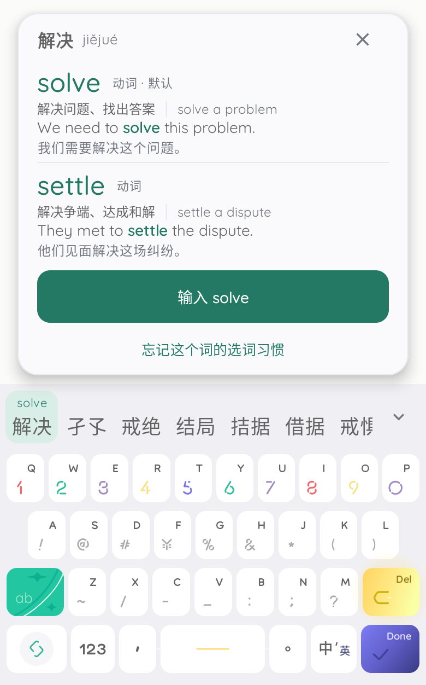

# 拾词输入法 · StudyIME

用中文打字，顺便记一个英文词。拾词是一款离线拼音输入法：英文释义显示在中文候选上方，点候选照常输入中文；想多看一眼，再长按打开释义。

**Android 是目前主要开发的平台，尚未提供公开 APK。** [Android 获取与启用](docs/releases.md#android) · [从源码构建](android/README.md#构建环境)

## 在 Android 上试打

用全拼输入 `jiejue`，候选「解决」上方会显示 `solve`。点一下输入「解决」；长按则能对照 `solve a problem`（解决问题）与 `settle a dispute`（解决争端）。只有点「输入 solve」才会把英文送入输入框。

- **输入方式**：全拼、自然码双拼和小鹤双拼；中文选词学习和英文释义可以分别开关。
- **键盘外观**：[默认和轻彩两套皮肤](docs/android-skins.md)，都支持浅色和深色，也可以调整字号与键盘高度。
- **离线使用**：拼音转换、选词和查释义都在设备上完成，输入法不申请网络权限。[词库来源与审核状态](data/lexicon-expansion/android-runtime/README.md)

支持范围从 Android 10（API 29）起，构建包含 `arm64-v8a` 和 `x86_64`。上图来自开发模拟器；最低系统版本和打包架构不等于所有设备都已实测。见 [Android 开发说明](android/README.md) 与[验证记录](docs/android-validation.md)。

## Windows 版

Windows 11 x64 版仍在实验阶段，暂不提供面向普通用户的安装包，也不影响 Android 单独发版。对桌面输入法感兴趣的开发者可以查看 [Windows 打包进度](docs/packaging.md)与[桌面验收记录](docs/installed-desktop-acceptance.md)。

## 许可

拾词原创代码采用 GPL-3.0-or-later。词库、字体和其他第三方材料分别保留其许可与署名，见[版权说明](COPYING.md)、[Android 词库声明](data/lexicon-expansion/android-runtime/NOTICE.txt)和[专名数据来源](data/lexicon-expansion/android-names/README.md)。
