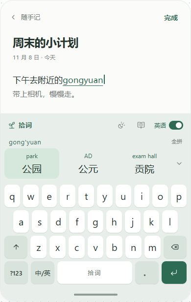
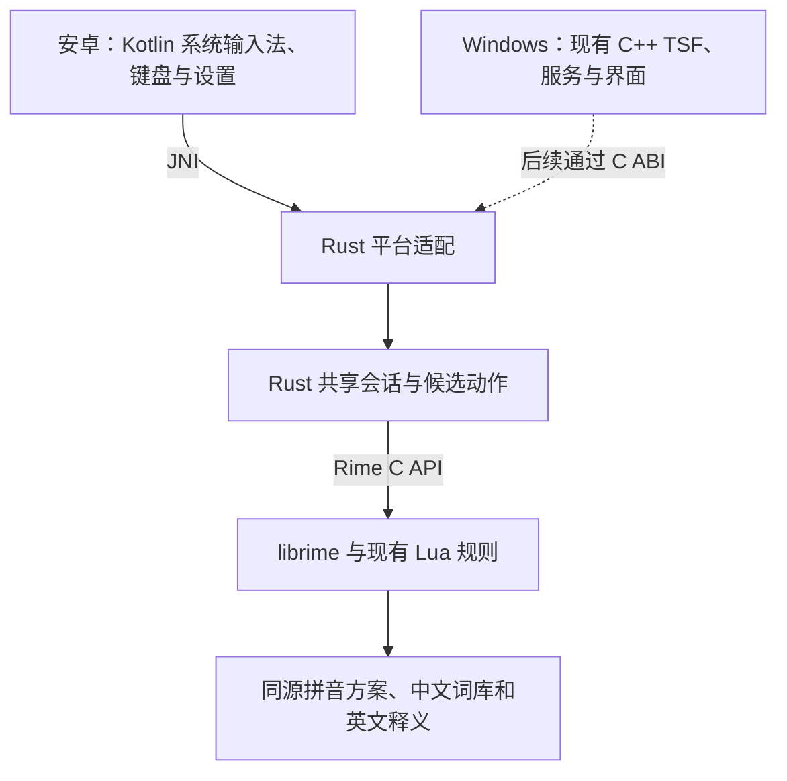

# 拾词输入法：安卓开发与 Rust 共享核心计划

日期：2026-11-08。规划分支：`codex/android-rust-plan`；后续开发分支：`codex/android-dev`，使用本聊天绑定的独立工作树，见 [并行开发目录](parallel-development.md)。计划起点为 Windows 开发分支 `codex/technical-spike` 的 `7713de71778d08db06fceac9d79055bb1abc707f`。

目标是在安卓上提供美观、流畅、可以日常使用的拾词键盘，延续“正常中文输入，顺便看到英文”的产品行为。采用 **Kotlin 原生界面＋Rust 业务核心＋librime／现有 Lua**；后续让 Windows 接入同一份 Rust 核心，保留已验证的桌面系统接口与界面。

**当前状态：Android 开发预览与已记录的模拟器验证。** P0／P1 和本次 P2／P3 模拟器范围完成，包含 600 条三方案回归、原生输入、恢复、42 组截图与交互录像。P4 的候选 p95、启动耗时和真机项目仍未全部达到条件，具体数字见 [验证记录](android-validation.md)。实时断点见 [安卓交接](android-handoff.md)，构建方法见 [Android README](../android/README.md)。Windows 后续迁移尚未实施。

## 1. 产品方向与首版范围

| 事项 | 本计划的安排 |
| --- | --- |
| 产品 | 独立的拾词安卓输入法，提供启用引导、软键盘和设置页 |
| 界面 | Kotlin＋Jetpack Compose 定制；美观、触感与流畅度共同验收 |
| 核心 | Rust 管理会话、版本、候选动作及跨平台业务模型 |
| 引擎 | 继续使用 librime 和 librime-lua，不重写中文解码、排序与用户词典 |
| 释义 | 首版沿用同一份 Lua 规则及现有词库流程，避免两套释义判断 |
| 平台假设 | 暂以 Android 10／API 29 及以上、arm64-v8a 为目标；x86_64 用于模拟器，P0 根据实际设备核定 |
| 长期复用 | 安卓先验证 Rust 核心，Windows 再逐步接入；平台界面分别实现 |

P0 已将 minSdk 29、compileSdk／targetSdk 35 和其余工具版本写入 [工具链锁](../android/toolchain.lock.json)。实际运行验证目前为 Android 11／API 30 x86_64 模拟器；manifest 中的版本下限及打包 arm64 不代表相应设备已经实测。

### 首版必须交付

- 26 键键盘，全拼、自然码双拼、小鹤双拼；中英文切换、数字、常用符号、删除、空格和编辑器动作键。
- 英文在上、中文在下的双行候选，候选展开／翻页、完整释义、明确的英文提交。
- 独立的“显示英文释义”与“记住中文选词习惯”开关；三种拼音方案共用安卓端本地用户词典，提供逐词遗忘。
- 浅色／深色外观、必要的字号与键盘高度设置、轻微按压反馈、减少动态效果支持。
- 安装后启用引导、方案选择、词库版本与许可说明、输入法切换入口，以及可重复构建的开发 APK。
- 在实际应用中验证输入、编辑、焦点切换、生命周期恢复及性能，记录被测设备和构建版本。

首版暂不包含九宫格、滑行输入、语音、手写、英语预测纠错、账号、云同步、整句 AI 翻译或复杂复习系统。九宫格涉及选音和拼音歧义，作为独立后续功能评估。

## 2. 视觉参考与原生验收

设计参考已随分支保存：[可操作示意](../prototype/android/index.html)、[示意源](../prototype/android/concept.html)、[说明](../prototype/android/README.md)。

[深色参考](../prototype/android/dark.png)与浅色采用相同几何结构。以上为网页设计示意，固定候选和笔记只用于演示；不代表真实 Android、Compose 或 Rime 的运行结果，也不用于扩充正式词库。

### 视觉方向

- 延续已经认可的双行候选。中文是主要操作信息，英文是清晰、克制的辅助信息；整项使用同一个高亮和点击区域。
- 默认使用清浅绿、柔和按键底色与轻微层次。先完成这一套完整主题，再考虑增加皮肤。
- 参考示意的按键圆角为 9 CSS px；原生尺寸需转换成 dp／sp 并在设备上调整，不能直接把网页像素当成 Android 尺寸。
- 候选英文可以单行省略，完整内容通过释义面板查看。窄屏优先减少可见项并提供展开，保留中文和英文的可读字号。
- 学习开关收起英文行时保持键盘底部锚点、组合内容和选中项；按压和候选动画不阻塞真实输入。
- 设置页沿用同一套字体、色彩、间距、圆角与图标规范。把默认、按下、禁用、长词、缺词、展开和恢复状态一起设计。

### 必须验证的视觉条件

| 条件 | 验收要求 |
| --- | --- |
| 屏幕宽度 | 至少覆盖 320、360、390、430 dp 的布局；横屏单独处理，不横向拉伸截图 |
| 字体缩放 | 检查 1.0、1.3、1.5、2.0；用布局与可见候选数适配，避免强制缩小用户字号 |
| 主题 | 浅深色均检查文字、按键、选中项、禁用项和浮层对比度 |
| 对比度目标 | 普通文字至少 4.5:1，大字及必要图标至少 3:1；这是设计目标，需以实际颜色测量 |
| 触摸 | 工具按钮按至少 48 dp 的有效触区设计；26 键利用完整键位单元，实测邻键误触及长按取消 |
| 系统区域 | 检查手势导航、三键导航、横屏和窗口 inset，底行与释义面板不被遮挡 |
| 动效 | 按压反馈先按 60–90 ms、候选切换约 160–180 ms、英文行展开约 180–240 ms 试做，再按实机调整 |
| 可访问性 | TalkBack 能区分中文候选、英文释义和明确提交动作；放大字体及减少动态效果仍可用 |

原生评审使用同一组场景与参考图对照，另录制真实点击、长按、快速输入和主题切换。网页截图可用于比较设计，不能作为原生还原或真机流畅度的通过证据。

## 3. 核心交互约定

1. 点击候选的中文或英文区域，均提交中文；空格沿用正常中文选词行为。
2. 长按候选或使用释义按钮，打开完整释义；只有明确点击“输入英文”才提交英文。长按完成后不得又触发普通点击。
3. 缺少可靠释义时英文留空，中文仍可输入；关闭英语显示立即禁用英文提交与释义操作。
4. 英文提交继续要求候选覆盖整段组合且光标位于末尾；存在已确认分段或剩余拼音时禁用该动作，保留当前组合。
5. 提交使用引擎重新验证的完整词表值；候选行的省略文字、菜单标签或 Kotlin 缓存不作为提交来源。
6. 组合、候选页、选中项、学习状态、方案或输入框发生相关变化，旧的英文／遗忘目标失效。
7. 中文学习开关独立于英语显示。暂停学习保留已有词频；逐词遗忘针对当前词与读音，不修改应用正文。
8. 输入方案在组合完成后切换；更改设置不清空正在输入的拼音。安卓本地三种方案共用用户词典，跨设备同步另行规划。
9. 回车根据当前编辑器处理发送、搜索、下一项、完成或换行；不使用统一的回车模拟替代所有编辑器动作。

这些约定继承 [Windows 设计](design.md)、[双拼行为](double-pinyin.md)和[中文学习行为](word-frequency.md)，用触摸操作适配手机。

## 4. 架构与边界

Rust 的收益主要是共享逻辑、清晰的生命周期与可独立验证的状态模型。输入质量继续依赖 Rime 和词库；Rust 不能自动消除 C++ 引擎及 FFI 边界的问题，也不自动保证更低延迟。

### 建议模块

以下为已经实现的模块结构；Windows bridge 在后续桌面阶段再增加。

| 拟建位置 | 职责 |
| --- | --- |
| `android/app` | InputMethodService、InputConnection、Compose 界面、启用引导、EditorInfo 适配及本机设置持久化 |
| `crates/study-core` | 与平台无关的事件、状态、会话版本、候选目标及动作校验 |
| `crates/study-rime-sys` | 从固定头文件生成或审阅的 Rime C 绑定，集中容纳 unsafe 边界 |
| `crates/study-rime` | 安全封装 Rime 会话与结果生命周期，复用现有 Lua 查询／提交协议 |
| `crates/study-android` | JNI、平台参数与错误转换，构建 Android 动态库 |
| `crates/study-windows-bridge` | 后续 Windows 使用的窄 C ABI；在桌面接入阶段再增加 |

界面默认使用 Compose 定制。P1 验证 InputMethodService 中 Compose 所需的生命周期、SavedState 与 ViewModel owner，以及 View 销毁后的释放；P2 在真机测量按键路径。若确有局部绘制瓶颈，再评估替换键盘绘制层并保持视觉和交互约定。

### 线程、数据与提交

- Kotlin 将引擎事件送入一个串行工作线程，由该线程同步调用 Rust／Rime。UI、磁盘部署、引擎通知的职责明确分开，首版不额外引入两套异步运行时。
- 一个进程中的 Rime 实例只有一个明确的初始化／关闭拥有者；各输入会话按引擎约束串行访问。维护通知转成消息，不直接回调 UI 或持有跨线程 JNIEnv。
- 每次事件返回一次完整、不可变的快照，包含输入框代次、会话版本、预编辑、候选、模式和动作可用性。减少按键路径上零碎的 JNI 调用。
- Android 层在输入框切换时立即提升代次；丢弃迟到结果，旧任务不能向新输入框提交文字。
- `InputConnection` 由 Android 层持有与使用。将预编辑与最终提交分开，对齐拼音分段、光标、选区及 composing region。
- 区分输入法自身引起的选区回调和应用／用户移动光标，避免正常输入触发错误清空。
- 每条提交带唯一 ID，同一目标只尝试一次；连接失效或结果不确定时不盲目重发。定义失败后的组合恢复／取消行为，不把旧文本转发到新输入框。
- Rime 借用的文本及时复制为自有数据，并配对释放 context／commit。C 结构布局、字符串编码、空指针、错误与 panic 都在 FFI 边界检查。
- Kotlin 接口接收不透明句柄或类型化数据，不直接持有可任意解引用的 Rust／Rime 指针。

### 数据与构建

- 从现有同源方案、Lua 和词库构建安卓资源；Android 原生库使用 NDK 重新构建，不能沿用 Windows DLL 或其二进制缓存。
- 初次部署与词典编译放在后台准备流程；完成后原子切换资源版本，保留旧版本以便失败恢复。升级不覆盖用户词典。
- UI 偏好由 Android 本机设置层持久化，并向 Rust 传递版本化配置快照；共享配置模型不意味着两端必须使用同一种磁盘格式。
- 锁定 Gradle、JDK、Kotlin／Compose、Rust、NDK 和引擎源码／补丁，记录实际构建输入及 APK 摘要。
- 新增 Kotlin／Rust 代码沿用项目已确认的 GPL-3.0-or-later；第三方组件保留各自许可，中文基础与英文学习数据继续按现有 CC BY-SA 4.0 来源和审核流程分发。
- 检查 arm64 与模拟器 ABI、C++ 运行时依赖、全部原生库的 16 KB 页面兼容性及打包布局；未验证前不声明支持。
- 初版的输入、查词与学习使用本地数据，默认不加入联网能力。密码字段停用学习和释义；尊重禁止个性化学习的编辑器标志。
- 用户词典放在应用私有目录；显式配置 Android 备份规则，避免“本机保存”的数据被默认云备份。发布日志不记录原始输入或完整聊天内容。

## 5. 现有资产的复用方式

| 现有资产 | 安卓计划 |
| --- | --- |
| [三种拼音方案](../packaging/data/study.schema.yaml)及对应双拼文件 | 复用方案源与键位规则，按 Android 引擎重新部署 |
| [study_core.lua](../src/study/lua/study_core.lua) | 首版继续作为释义查询、英文资格与英文提交的权威实现 |
| [RimeSession.cpp](../src/study/RimeSession.cpp)、[SessionActions.cpp](../src/study/SessionActions.cpp) | 移植会话版本和候选动作约定到 Rust，用固定输入做行为对照 |
| [StudyService](../src/study/StudyService.cpp)及现有协议 | 借鉴会话保护；安卓不照搬 Windows 管道协议，后续桌面适配保持客户端协议兼容 |
| [中文学习控制](word-frequency.md) | 携带现有 `Memory::OnCommit` 暂停学习补丁，验证跨方案学习和遗忘 |
| [引擎来源锁定](../licensing/product-sources.lock.json) | 优先沿用固定引擎／插件源码，Android 构建差异单独记录 |
| [词库与审核流程](lexicon.md) | 复用同一数据产线和许可证；未审核的词条继续标注开发预览 |
| 已有 Windows 检查 | 复用测试场景及预期，不把历史通过结果算成 Android 已通过 |

当前 200 条释义仍待人工审核。外部模型扩充草稿的状态见 [词库扩充记录](lexicon-expansion.md)，本计划不启动模型请求，也不把网页固定示例混入运行词库。中文词库扩大与英文释义覆盖率分开统计。

## 6. 安卓阶段交付

各阶段按通过条件推进，不用未经验证的日历估算替代进度。工程与原生键盘已经实现，具体构建、模拟器结果和待补验项以 [验证记录](android-validation.md) 为准。

| 阶段 | 主要工作 | 可审阅交付与通过条件 |
| --- | --- | --- |
| P0：固定环境与接口 | 确定目标手机、SDK／NDK／Rust 版本、资源来源及模块边界，建立最小构建 | 锁定记录、构建说明；Kotlin 能加载 Rust 动态库，Android 上能初始化固定 Rime／Lua 并返回真实候选 |
| P1：真实输入闭环 | 实现 IME 生命周期、串行引擎线程、预编辑和提交；接入现有释义动作 | 可安装的最小开发 APK；在测试编辑器中完成按键→Rime→双行候选→中文／英文提交，删除和切换输入框正确 |
| P2：界面还原 | 按参考实现键盘、候选、完整释义、浅深色、开关、动画与触摸反馈 | 同场景原生截图和交互录像；通过第 2 节视觉检查，连续输入不等待动画，处理长词、缺词和窄屏 |
| P3：日常功能完整 | 接入两套双拼、词频、逐词遗忘、符号、编辑器动作、设置与升级恢复 | 三种输入方案及本地学习行为一致；重建进程、切换方案和资源升级保留预期状态；密码等特殊输入框适配正确 |
| P4：真机稳定与开发预览交付 | 在常用应用和目标设备验证，完成性能、内存、许可及构建材料 | APK、源码／依赖说明、设备矩阵和已知问题；每项结果关联真实版本，未完成项明确保留 |

P0 首次构建前核对已有开发工具，避免重复安装或无必要升级。P1 的系统输入闭环优先于扩展功能；P2 是首版的重要交付，不作为发布前才补做的美化。

## 7. 功能与性能验收

### 功能重点

- 以现有三种方案各 200 条、共 600 条中英文回归场景作为可移植起点，在 Android 构建上重新运行适用用例。
- 覆盖零声母、ü、简拼、拼音分隔、分段选词、连续删除、光标移动、选区替换、翻页及空候选。
- 覆盖英文缺词、长释义、部分组合、快速开关、重复点击、过期菜单和后台结果迟到；拒绝动作不能丢失剩余拼音。
- 覆盖三种方案共用词频、暂停新学习、遗忘、重启恢复及资源升级；不在真实个人词典上运行破坏性测试。
- 在微信、浏览器、备忘录或同类真实编辑器中检查中文、英文、发送／搜索／换行以及多行编辑。应用与版本按实际设备记录。
- 检查锁屏／解锁、前后台、服务或进程重建、应用切换、键盘隐藏重开、横竖屏与输入法切换。
- 密码、手机号、数字、邮箱、网址及禁止个性化学习的输入框分别检查；不能用普通文本框代替全部场景。

### 暂定性能目标

在 P0 选定的设备上以发布优化构建测量，P1 取得基线后再确认预算。以下数字为目标，不是已达到的结果。

| 指标 | 初始目标与测量边界 |
| --- | --- |
| 按压反馈 | 争取在下一可呈现帧显示；每键路径不等待磁盘、部署或网络 |
| 候选更新 | 暖态从按键事件到新候选可见，p95 ≤ 50 ms、p99 ≤ 100 ms；注明设备刷新率和样本 |
| 键盘出现 | 在词库已部署的条件下，暖态 p95 ≤ 100 ms、冷态 p95 ≤ 500 ms；首次词库部署单独计时 |
| 连续输入 | 快速输入、删改和翻页不丢键、不重复提交、不积压视觉动画；分别观察 60 Hz 与高刷新率设备 |
| 资源 | 记录冷启动峰值、稳定内存、反复开关后的增长、APK／安装体积；取得真实基线后确定上限 |

性能改动使用同一设备、构建模式、词库和输入序列比较。桌面端已有延迟数字不外推到手机。功能修改只补跑受影响的必要检查，阶段验收再执行完整对应矩阵。

## 8. Windows 后续如何接入 Rust

**长期统一共享业务核心，逐步替换重复逻辑。** 保留现有 C++ TSF、Win32 界面、服务启动与系统注册；由它们调用 Rust。librime 仍是原有 C++ 引擎，Lua 释义规则仍是两端同源。

| 层次 | Windows 后续安排 |
| --- | --- |
| 会话版本、候选目标和英文／遗忘动作 | 优先接入 `study-core` 与 `study-rime`，消除两端重复实现 |
| 配置模型、资源版本规则 | 在行为一致的前提下逐步共享；Windows INI 和 Android 设置存储继续各自适配 |
| TSF、COM、Win32、窗口和 IPC | 先保留现有实现与对外协议，由窄 C ABI 连接 Rust |
| Rime、Lua、拼音方案和词库 | 继续复用，重新核对各平台构建与许可 |
| 桌面界面重设计或系统层 Rust 化 | 按实际体验或维护收益另行决定，不列为共享核心的前置 |

### 迁移顺序

1. **W0：对照接口。** 安卓核心达到 P3／P4 的稳定条件后，固定当前 Windows 行为样本；在独立用户目录和隔离会话中分别运行原 C++ 路径与 Rust 路径。禁止在同一生产会话上双重执行提交或学习。
2. **W1：接入会话与候选动作。** 用 `study-windows-bridge` 暴露不透明句柄、定长字段或指针／长度及配套释放函数。字符串、错误和 panic 在边界转换，不跨 C ABI 暴露 Rust 的 `String`、`Vec` 或异常。
3. **W2：替换重复业务层。** Windows 服务仍拥有现有 Rime 实例并领取 commit；Rust 绑定该实例的已有会话，不创建第二个引擎、不重复领取提交。保持当前串行服务线程、TSF 编辑会话和候选窗口协议。
4. **W3：验证与收敛。** 完成引擎行为对照、IPC／TSF、学习、双拼、升级及真实应用回归后，再移除已被替代的 C++ 业务实现。构建材料记录 Rust、MSVC／CRT 和桥接库的输入；保留可回退的已验证版本。

Windows 引擎会话是“借用现有会话”，Android 可以“拥有本平台会话”；Rust 封装必须区分这两种生命周期。共享代码不等于共享进程、用户词典文件或账号，跨设备同步仍不在首版范围。

此路线可以逐步减少两端维护差异，同时继续使用现有 Windows 测试与界面成果。把全部 Windows 代码一次性重写为 Rust 并非本计划的交付目标。

## 9. 风险与处理顺序

| 具体风险 | 处理方式 |
| --- | --- |
| Compose 在 IME 服务中的生命周期与首帧成本 | P1 即验证 owner、释放和首帧；根据实测优化局部路径 |
| Rust／JNI／C API 增加构建与调试成本 | P0 先打通最小链路，锁定工具链，保持桥接接口小而稳定 |
| 旧候选或后台提交进入新输入框 | 输入框代次＋会话版本校验，提交仅由平台适配层消费一次 |
| 缺失自定义 Rime 学习补丁 | 构建清单明确补丁，P3 验证暂停和恢复，不只复制 YAML |
| 手机键盘好看但触摸体验差 | 视觉与连续输入一起验收，记录命中区、误触、长按取消和帧表现 |
| 两端释义逻辑逐渐分叉 | 首版共用现有 Lua 和数据产线；后续迁移需先通过两端行为对照 |
| 原型被当成原生或词库验收 | 参考文件、Android 程序检查、模拟器观察和真机观察分别标注 |
| 未审核数据被当作正式词库 | 继续沿用现有审核、来源和版本标识；公开发行条件另行核验 |

## 10. 本分支交付与下一步

- [x] 从 `7713de7` 建立 `codex/android-rust-plan`。
- [x] 保存用户认可的网页交互示意与浅深色参考。
- [x] 写明安卓技术边界、视觉验收、分阶段交付和 Windows 后续迁移方式。
- [x] 从计划提交 `a4d859b` 创建独立安卓工作树及 `codex/android-dev`；待词库后台停止后，备份并将原目录恢复到 `codex/technical-spike`，保留其未提交改动。见 [并行开发记录](parallel-development.md)。
- [x] P0：固定工具链和 Android 11 x86_64 模拟器，两个目标 ABI 编译；Kotlin→Rust→Rime 返回真实候选。
- [x] P1：模拟器中原生输入闭环、中文／英文动作和 16 项真实 IME 交互首轮通过。
- [x] P2 的本次模拟器范围：38 项布局检查、42 组原生截图、放大字号修正与真实交互录像；真机触感、物理帧表现及实际 TalkBack 另列待补验。
- [x] P3 的本次模拟器范围：三方案／学习、11 项资源恢复、14 项生命周期、15 项特殊场景；跨 Activity／进程的原生组合恢复边界见验证记录。
- [x] 开发预览交付材料：优化 APK、项目／第三方原生源码、许可、构建和实际应用／性能报告，所有结果绑定实际 APK。
- [ ] P4 完整验收：候选 p95 与新进程启动性能仍待优化；真机、实际 16 KB 页面、高刷新率、TalkBack、锁屏与常用应用等待补验。
- [ ] W0–W3：在共享核心稳定后逐步接入 Windows。

本次没有改动 Windows 产品代码、运行数据、安装状态或词库审核记录，也没有生成新版 Windows 包。Windows 当前待办继续参见 [交接](handoff.md)和[优化待办](optimization-todo.md)。

技术参考：[Android 输入法接入](https://developer.android.com/develop/ui/views/touch-and-input/creating-input-method)、[Compose 自定义设计体系](https://developer.android.com/develop/ui/compose/designsystems/custom)、[JNI 边界建议](https://developer.android.com/ndk/guides/jni-tips)、[Rust Android 目标](https://doc.rust-lang.org/rustc/platform-support/android.html)、[cargo-ndk](https://github.com/bbqsrc/cargo-ndk)、[Rime C API](https://github.com/rime/librime/blob/master/src/rime_api.h)。这些资料用于实现参考，具体版本与兼容性仍在 P0 固定并验证。
