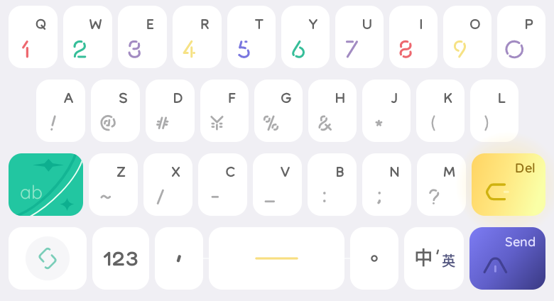

# Android 皮肤切换

轻彩沿用[早期交互设计稿](../prototype/android/compact-candidates/README.md)的双层键标与数字页。下图是按新参考图调整后的 Android 原生键盘（浅色，发送输入框；仅裁出四行键区）。



## 使用

- 待机工具栏依次显示设置、外观、[剪贴板](android-clipboard.md)和英译，四个图标等距居中。英译气泡右下角的绿勾表示显示英文释义，短横表示隐藏；它不是中英文输入模式开关。
- 点工具栏的设置图标，在键盘区域内选择“默认 / 轻彩”。输入过程中可长按候选栏的展开按钮，或先展开候选再点设置图标。
- “皮肤”和“外观”独立保存；外观支持自动、浅色、深色。换肤保持当前组合文字、英译开关、大小写和数字／字母页。
- 应用的“键盘设置”也提供同一组皮肤选项。重启输入法后恢复皮肤和外观；新的输入框仍按其输入类型选择字母／数字页。
- 默认保留浅绿配色和系统字体。轻彩采用灰紫底、圆润白色键帽、右上方的石墨色圆体大写字母，以及左下方的彩色断笔数字／灰色符号。
- 轻彩字母页点按输入字母，长按约 480ms 输入左下副标。点“123”后在相同键位上互换两层内容，点按输入右上数字／符号，长按输入左下字母；“ABC”返回字母页。
- 长按“123 / ABC”进入更多符号，保留引号、美元、括号等完整符号入口。滑动超过 Android 触摸容差会取消点按和长按；删除键继续支持按住重复删除。
- 两套皮肤的底排从左至右为：单词详情、123／ABC、逗号、空格、句号、中／英、确认。点左下角详情键查看当前高亮候选，不会提交文字；没有候选时该键置灰。逗号随中／英文模式输入 `，` 或 `,`。
- 确认键遵循输入框的搜索、发送、下一项、完成或换行操作；组合输入时先确认中文。长按候选只打开释义，明确点“输入英文”才提交英文。

## 布局与资源

两套皮肤共用键位和高度，字母页四行 35 键。竖屏待机工具栏和候选栏共用至少 60dp 的固定区域，隐藏独立拼音／模式行；拼音仍显示在应用编辑框中。候选英文在上、中文在下，通常容纳 6–7 个，窄屏或大字号减少数量，长文本单行省略。切换皮肤、首个候选到达及英译开关均不会改变这一栏高度。横屏保留原生侧栏候选，避免四行键盘被挤压。

Android 为三个输入方案单独生成 `menu/page_size: 9` 补丁，为紧凑候选栏和展开面板提供足够的真实候选；Windows 的原始五候选配置保持独立。没有加入网页演示词条。

26 个大写字标与副标共用光学中心：上层居键面宽度的 66%、高度的 30%，下层约为 35%、70%。图形按实际键面等比缩放，不因 `I` 比 `W` 窄而偏到右边；用户调大字号时给两层保留间距。Shift 的 `ab / AB` 使用 Quicksand 400，操作键标题用 Quicksand 600，“123 / ABC”用 Fredoka 500。英文释义仍用 Quicksand，中文使用 Android 系统字库。

字形源文件位于 `android/app/src/main/res/font`，上游固定提交、SHA-256 和 SIL OFL 1.1 许可位于 `android/app/src/main/assets/fonts`。字体保持原始字节，未修改轮廓或内部字体名称；应用“关于 → 开源许可”可以查看。两份字体合计 284,008 字节。普通构建与运行均不需要下载字体。

`SoftPopGlyphs.kt` 保存重新绘制的字母和断笔数字／符号路径，`SoftPopArtwork.kt` 负责键帽、渐变和功能键图案。薄荷 Shift 有双弧和星芒；删除键为柠黄开口轮廓；发送键为靛紫拱形，其他编辑器仍显示相应的搜索、确认或换行图案。空格仅显示居中的金色短线，读屏名称不变。路径和文字排版均缓存，不切片参考图，也不下载字体。改动仅在绘制层，不改变触区、按键事件或引擎配置。

## 验证命令

本轮使用独立 AOSP Android 11 实例 `127.0.0.1:5561`，数据位于 `.cache/android/skin-emulator`。与另一轮测试共用的 `5555` 实例分别安装和执行，防止 APK 被相互覆盖。换到其他设备时以 `devices -l` 的实际序列号为准。

```powershell
python -X utf8 tools/android/prepare_skin_fonts.py
python -X utf8 tools/android/prepare_data.py
python -X utf8 tools/android/build.py apk
python -X utf8 tools/android/build.py apk --debug
python -X utf8 tools/android/build.py tests
python -X utf8 tools/android/build.py lint
python -X utf8 tools/android/run_device_checks.py install --serial 127.0.0.1:5561
python -X utf8 tools/android/device.py --serial 127.0.0.1:5561 install -r android/app/build/outputs/apk/release/app-release.apk
python -X utf8 tools/android/run_device_checks.py skins --serial 127.0.0.1:5561 --ime-package org.studyime.android
python -X utf8 tools/android/collect_device_evidence.py skins --serial 127.0.0.1:5561
python -X utf8 tools/android/run_device_checks.py ime --serial 127.0.0.1:5561 --ime-package org.studyime.android
python -X utf8 tools/android/run_device_checks.py lifecycle --serial 127.0.0.1:5561 --ime-package org.studyime.android
```

`SkinSwitchTest` 验证两套皮肤的键位、输入保留、26 组点按／长按、一次大写、更多符号、滑动取消、浅深色／跟随系统、窄屏／大字号／横屏和两个设置入口同步。使用独立 Release 输入法时还会重启该进程，检查偏好恢复。结果与安装 APK 摘要保存在 `.cache/android/evidence/release-skin-switch-report.json`，真实截图与 UI 层级在 `skins` 子目录；图像审阅与结构断言分别记录。模拟器验证不能替代真机触感和高刷新率验收。

## 2026-11-20 键面复验

本页预览来自 Android 11 模拟器上实际安装的 Release APK（390 dp、1 倍字号）。Debug / Release 离线构建成功，3 项单元测试通过，换肤测试的 66 项检查全部通过，生成 26 组原生截图及 UI 层级。检查包括上下键标和空格短线的落点、发送态图案、35 个触区在两种皮肤下是否一致，以及 320 dp、深色、横屏和 2 倍系统字号下的输入。未做真机验收。

## 2026-11-13 接续验收

接续工作仍在 `.`、分支 `codex/android-skin-switch-quicksand` 中完成。最终 Release APK 为 `android/app/build/outputs/apk/release/app-release.apk`，16,409,933 字节，SHA-256 为 `99abd24a26e0022c23585a2cafb64ce66868ad3f6b116269eff95af27b64fdd1`。

- Debug、Release、instrumentation APK 构建成功，3 项单元测试通过；两种构建的 Lint 均为 0 错误、19 条警告。完整性检查通过，两份字体及其许可的摘要验证通过。
- 独立模拟器上的 Release 换肤测试通过 61 项检查，生成 26 组原生截图及 UI 层级。验证了窄屏与 1.3／2.0 倍系统字号、双层键标输入、横屏、系统外观跟随、进程重启恢复和两个设置入口同步。
- Release 真实输入框回归通过 16 项检查，包括中文选词、显式英文提交、Unicode 删除、焦点切换、搜索／发送／下一项／完成／换行动作，以及密码、邮箱、数字与电话输入框。结果在 `.cache/android/evidence/release-ime-interaction-report.json`。
- Release 生命周期回归通过 18 项检查，包括组合输入重开、编辑器重启、选区替换、跨输入框手势取消、方案切换、横竖屏后重新输入、快速连续输入、第 9 个候选滚动选取、15 次键盘重开和输入法进程重建。结果在 `.cache/android/evidence/release-lifecycle-report.json`。横竖屏检查确认编辑框文字保留及重新输入可用，本次记录的 `rotationKeptNativeComposition` 为 `false`，不代表旋转后仍保留原生组合状态。
- 已审阅 18 张原生截图，确认“ABC”完整显示、上下键标分离、浅深色和候选栏布局。审阅记录在 `.cache/android/evidence/skin-visual-review.json`，与自动结构断言分开保存。
- 候选滚动回归已更新为检查第 9 项，避免继续把旧版第 5 项当作末尾候选。

构建日志为 `.cache/android/logs/gradle-skins-resumed-build.log`，源码及 APK 摘要在 `.cache/android/assembly-release.json`。换肤测试使用的 instrumentation APK 保存在 `.cache/android/evidence/skin-tested-artifacts`；随后只更新了候选滚动回归，Release APK 摘要保持一致。

收尾时已核对当前构建输入、Release APK、构建日志、三份设备报告对应的安装包与测试运行器，以及 18 张已审阅截图的摘要。三份设备报告合计 95 项检查通过，最后一项生命周期回归于北京时间 2026-11-13 21:35 完成。本次接续只补充验收记录，未改变已验证的 APK。
